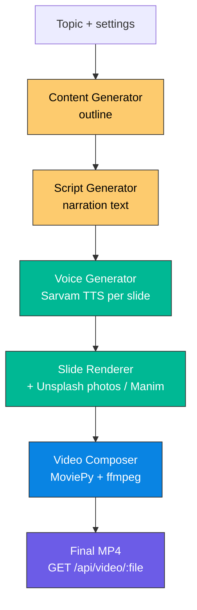
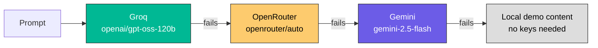
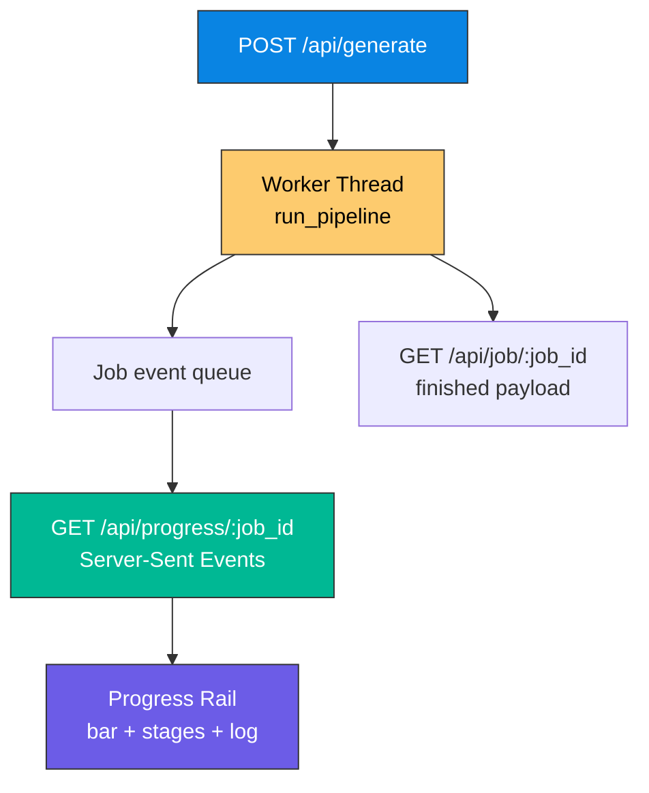

# Deckframe

**Turn any topic into a narrated, illustrated video deck — outline, voice, slides and a final MP4.**

### Live Demo

| Surface | Link |
|---|---|
| Local UI | http://localhost:5173 |
| API health | http://localhost:8000/health |

---

## Screenshots

| Composer | Live progress |
|---|---|
| Form with topic, slides, language, tone | Stage rail with live encode counter |

---

## What it does

- **Type a topic** → the pipeline drafts an outline, writes narration, synthesises voice, lays out slides and encodes a final MP4.
- **Three LLM providers, one chain** — Groq, OpenRouter and Gemini are tried in order, so a rate-limited or failing provider falls through to the next instead of failing the run. With no keys at all, deterministic local content is generated and the whole pipeline still completes.
- **Real progress over SSE** — the progress rail streams live, including a frame-by-frame counter during the encode, which is the slowest stage.
- **Real media when keys are present** — Sarvam AI voice-over, real Unsplash photographs per slide, and Manim animations where they earn their place.

---

## Architecture

### 1. Generation Pipeline

Every run moves through the same five stages. Progress is published to the UI after each.



### 2. LLM Provider Chain

`LLMClient` exposes one `generate_json` / `generate_code` interface. Each provider is tried in turn until one returns a usable answer.



### 3. Progress Flow

Generation runs on a worker thread. Each job owns a queue that the SSE endpoint drains, so the stream stays live for the whole run and several jobs can be tracked at once.



---

## Tech Stack

| Layer | Choice | Why |
|---|---|---|
| Backend | **FastAPI** | Async server, native SSE streaming |
| LLM | **Groq** → **OpenRouter** → **Gemini** | Ordered fallback chain, one interface |
| Voice | **Sarvam AI** `bulbul:v3` | Indian-language TTS |
| Imagery | **Unsplash** | Real photographs, not placeholders |
| Animation | **Manim** | Programmatic motion where it earns its place |
| Video | **MoviePy** + **ffmpeg** | Slide + audio muxing to MP4 |
| Frontend | **React 19** + **Vite 7** + **Tailwind 4** | Live progress UI |
| State | `useJobProgress` (SSE hook) | Single progress channel |

---

## API

| Method | Path | Description |
|---|---|---|
| `GET` | `/health` | Status plus which providers are live |
| `POST` | `/api/generate` | `{topic, num_slides, language, tone}` → `{job_id}` |
| `GET` | `/api/progress/{job_id}` | SSE progress stream |
| `GET` | `/api/job/{job_id}` | Finished payload (409 while running) |
| `GET` | `/api/video/{filename}` | Stream the MP4, supports range requests |
| `GET` | `/api/content/{job_id}` | Outline for a finished job |
| `GET` | `/api/script/{job_id}` | Narration for a finished job |

```bash
curl -X POST localhost:8000/api/generate \
  -H 'Content-Type: application/json' \
  -d '{"topic":"How a refrigerator works","num_slides":5,"language":"english","tone":"formal"}'
```

---

## Project Structure

```
AI-Video-Gen/
├── backend/
│   ├── app.py                  # FastAPI app, job registry, SSE
│   ├── config.py               # Keys, paths, font resolution, capability
│   ├── generators/
│   │   ├── llm_client.py       # One JSON/code interface over Groq, OpenRouter, Gemini
│   │   ├── content_generator.py# Outline
│   │   ├── script_generator.py # Narration
│   │   ├── voice_generator.py  # Sarvam TTS / fallback
│   │   ├── image_fetcher.py    # Unsplash / generated plate
│   │   └── manim_generator.py  # Animation scene code
│   ├── utils/
│   │   ├── slide_renderer.py   # 1920x1080 slide images
│   │   ├── video_renderer.py   # Manim render to MP4
│   │   └── video_composer.py   # Slides + narration → final MP4
│   ├── outputs/                # Generated at runtime (gitignored)
│   └── requirements.txt
├── frontend/
│   ├── index.html
│   └── src/
│       ├── App.jsx             # Layout and view switching
│       ├── components/         # Composer, ProgressPanel, Player, ModeBadge
│       ├── hooks/              # useJobProgress (SSE), useCapabilities
│       └── utils/api.js        # Backend client
├── setup.sh
└── README.md
```

External providers sit behind one `LLMClient` interface — adding or reordering a provider touches one file.

---

## Local Setup

**Prereqs:** Python 3.12, Node 18+, ffmpeg, cairo + pango, a sans-serif font.

```bash
git clone https://github.com/Kamal-Nayan-Kumar/AI-Video-Gen.git
cd AI-Video-Gen
./setup.sh
```

`setup.sh` creates the Python environment, installs both halves, and checks
ffmpeg and a usable font are present. Then run the two servers:

```bash
# Terminal 1 — API
cd backend && .venv/bin/python app.py
```

```bash
# Terminal 2 — UI
cd frontend && npm run dev
```

Open **http://localhost:5173**.

### If port 8000 is taken

```bash
cd backend && PORT=8010 .venv/bin/python app.py
cd frontend && API_TARGET=http://127.0.0.1:8010 npm run dev
```

---

## API Keys

All keys are optional. With none, the app runs in **demo mode** and still
produces a complete video from local fallbacks.

Copy `backend/.env.example` to `backend/.env` and fill in what you have:

| Key | Stage that goes live | Get it | Free tier |
|---|---|---|---|
| `GROQ_API_KEY` | Outline, script, animation code | [console.groq.com/keys](https://console.groq.com/keys) | Yes, generous |
| `OPENROUTER_API_KEY` | Same, as automatic fallback | [openrouter.ai/keys](https://openrouter.ai/keys) | Free tier, 50 free req/day |
| `GEMINI_API_KEY` | Same, last LLM fallback | [aistudio.google.com/apikey](https://aistudio.google.com/apikey) | Yes |
| `SARVAM_API_KEY` | Narration voice | [dashboard.sarvam.ai](https://dashboard.sarvam.ai) | Limited |
| `UNSPLASH_ACCESS_KEY` | Real slide photographs | [unsplash.com/developers](https://unsplash.com/developers) | Yes, 50 req/hr |

Only **one** LLM key is required. The chain tries them in order, so a missing
or rate-limited provider is skipped automatically.

### OpenRouter model routing

OpenRouter offers two "universal" router IDs. There is no single fixed model —
the router picks one per request and the chosen model is returned in
`response.model`.

| ID | Behaviour | Cost |
|---|---|---|
| `openrouter/free` | Picks a random compatible free model | Free |
| `openrouter/auto` | Routes by prompt task and capabilities | Billed at the selected model's rates |

`openrouter/auto` is the default. It tested 3/3 on this pipeline and bills at
roughly a tenth of a cent per deck. `openrouter/free` is free but shares a
50-request/day cap and returned an empty response to about one request in three
during testing, so a run silently fell through to local content. Set
`OPENROUTER_MODEL=openrouter/free` in `.env` if you would rather pay nothing
and accept occasional fallback to local content.

---

## Modes

`GET /health` reports which stages use a real provider:

```json
{
  "status": "ok",
  "capabilities": {
    "mode": "live",
    "content": true,
    "llm_providers": ["groq", "openrouter"],
    "provider": "groq",
    "voice": true,
    "images": true
  }
}
```

| Stage | Live provider | Fallback |
|---|---|---|
| Outline & script | Groq → OpenRouter → Gemini | Deterministic local outline |
| Narration | Sarvam AI | Local Google Translate voice |
| Imagery | Unsplash | Generated abstract plate |
| Animation | LLM scene code | Local Manim templates |

Set `DEMO_MODE=1` to force demo behaviour even when keys are present.

---

## Testing

```bash
cd frontend && npm run lint
```

The pipeline is exercised end to end by running `./setup.sh`, starting both
servers and submitting a topic; a five-slide deck takes roughly 40–90 seconds
depending on the machine.

---

## Notes

- A five-slide 1080p deck is CPU-bound to encode. The progress rail reports a
  live frame counter (`Encoding frame 538/1532`) so the slowest stage is
  visibly working, not stuck.
- The SSE stream sends a snapshot on connect, so a UI that attaches late or
  reconnects renders the correct bar immediately instead of sitting at 0%.
- Keep-alive comment frames hold the socket open through the encode, which is
  otherwise a long silence.
